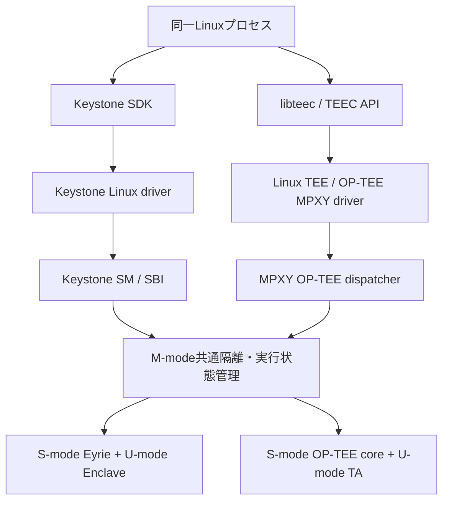

# Keystone用OpenSBIにOP-TEEを同居させるための追加機能

調査日：2026-11-16（JST）。対象：`yutaka-ishikawa/public` の
`main`、commit `b8e00948688c7d6d15a7f9b31a37dee51ce7905a`。
本書は現行ソースに基づく設計検討である。コード変更、ビルド、QEMU実行、実機試験は行っていない。
外部系列の調査結果は既存資料を参照しており、上流の最新状態を再検証したものではない。

## 1. 結論と要件

**同一LinuxプロセスがKeystone SDKとlibteecを併用する構成は設計可能である。
現行コードのままでは成立しない。最大の追加実装は、Keystone SMとOpenSBI domain切替を
またぐ共通PMP管理、およびLinux・Enclave・OP-TEEの実行状態と復帰先の管理である。**

ここでの同居は次の意味とする。

- 一つのプロセスがEnclaveを作成・実行し、OP-TEEのTA sessionを開いてコマンドを実行できる。
- Enclaveを保持・停止したままTAを実行でき、TA sessionを保持したままEnclaveを再開できる。
- 同じhartではLinuxからそれぞれを逐次呼び出す。複数hartでの並行実行は段階的に追加する。
- Enclave内からTAを直接呼ぶ経路、TAからEnclaveへ直接入る経路は初期要件に含めない。

単なる「起動時にどちらかを選ぶ」方式では要件を満たさない。一方、二つのAPIを
一つの新APIへ統合したり、EnclaveをOP-TEEのTAとして実装し直したりする必要はない。
Linuxへ戻ること自体はTA sessionのcloseやEnclaveのdestroyを意味しない。

## 2. 現在すでにある機能と不足

| 項目 | 現行ソースで確認した事実 | 同居に必要な変更 |
| --- | --- | --- |
| OP-TEE dispatcher | [fdt_mpxy_opteed.c](../opensbi/lib/utils/mpxy/fdt_mpxy_opteed.c)にCOMMUNICATE/COMPLETE、trusted/untrusted domain切替がある | 再追加は不要。呼出し権限、入力、復帰、共通隔離管理への接続を整える |
| 設定 | [k3_keystone_audit_defconfig](../opensbi/platform/generic/configs/k3_keystone_audit_defconfig)でも`CONFIG_FDT_MPXY_OPTEED=y` | configの有効化だけでは動かない。domain、DT、payloadを揃える |
| domain切替 | [sbi_domain_context.c](../opensbi/lib/sbi/sbi_domain_context.c)の`switch_to_next_domain_context()`はKeystone有効時にhangし、通常PMP再設定も除外 | 検証済みの共通遷移処理へ置換するまでgateを保持 |
| 起動時PMP | [sbi_hart.c](../opensbi/lib/sbi/sbi_hart.c)の`k3_keystone_root_pmp_configure()`がdomain領域を保存し、全域allowを最後へ配置 | root起動時の分割から、Linux/OP-TEE/Enclave各状態のpolicyへ拡張 |
| PMP slot計画 | [k3_keystone_boot_slots.h](../opensbi/include/sbi/k3_keystone_boot_slots.h)はQEMU用16 slot、fallback 15、Keystone用最低3 slot | OP-TEE常設領域と追加domain用の容量・優先順位を再計算。実機へ固定値を無条件適用しない |
| Enclave切替 | [enclave.c](../keystone/sm/src/enclave.c)がOS領域権限、EPM等、trap vector、timerを独自に変更 | domain切替を通らないためSM側も共通管理へ接続する |
| SBI権限 | [sm-sbi-opensbi.c](../keystone/sm/src/sm-sbi-opensbi.c)は主に`cpu_is_enclave_context()`でhost/enclave FIDを区別 | OP-TEE domainをLinux hostと区別し、許可domainを明示する |
| Linux OP-TEE | [mpxy_sbi.c](../linux-k3/drivers/tee/optee/mpxy_sbi.c)にper-CPU mailbox、TA呼出し、RPC処理がある。K3 defconfigもTEE/OPTEE有効 | 対応mailbox設定・DT・bootとの接続、CPU移動・hotplug・同居時の回帰確認 |
| FP/Vector | [thread.h](../keystone/sm/src/thread.h)にFP/Vector専用保存領域がない。現行domain切替にも保存処理がない | 両切替経路に保存・初期化・復元・消去を実装するか、未対応機能を強制禁止 |
| 起動・配布 | 現在のKeystone導入手順にOP-TEE payloadとユーザー空間一式の同居構成は確立されていない | payloadロード、予約領域、domain初期化、rootfsと検証手順を追加 |

既存の[取り込み計画](optee-opensbi-keystone-merge-plan.md)のP5を、今回の要件に具体化した文書である。
「dispatcherを取り込むこと」と「隔離を維持して双方を動かすこと」を別工程として扱う。

## 3. 推奨する呼出し構造

M-modeは共通の信頼基盤とする。OP-TEE coreもKeystone側も互いのprivate領域へ
S/U-modeからアクセスできないpolicyにする。OpenSBI domainはLinuxプロセスごとに作らず、
LinuxとOP-TEEの実行・資源所有権に用いる。Enclave IDとTA session IDは別管理のままでよい。

アプリの最小動作例は次の順序になる（APIの概念手順であり実行済みコードではない）。

1. Keystone SDKでEnclaveを作成する。
2. `TEEC_InitializeContext()`、`TEEC_OpenSession()`でTAを開く。
3. EnclaveをRUNし、OCALL等でLinuxに戻る。
4. 同一プロセスが`TEEC_InvokeCommand()`を呼び、必要なRPCを経てLinuxへ戻る。
5. 同じEnclaveをRESUMEし、TA sessionを引き続き利用する。
6. session/contextをclose/finalizeし、Enclaveをdestroyする。

EnclaveからTAを使いたい場合も、まずOCALLでhostへ戻し、hostがlibteecを呼ぶ構成で足りる。
UTMとTEE shared memoryを介するデータはLinuxから見える。hostを介して秘密を交換する
追加要件がある場合は、相互認証と暗号化したメッセージを別途設計する。
同一PIDであることだけではTAとEnclaveの暗号学的な同一性・信頼は成立しない。

## 4. 必須追加機能

### 4.1 共通PMP policy管理：最優先

PMP CSRを書き換える最終権限をM-mode内の一つの管理層へ集約する。
SMとOpenSBIが独立に全slotを再設定する方式は採らない。
既存のslot bitmap分割は再利用できるが、それだけではdomain切替の認可にならない。

管理対象はOpenSBI/SM常設領域、OP-TEE core/private pool、各EnclaveのEPM、UTM、
backing領域、TEE共有メモリー、MMIO、通常Linux RAMとする。
各領域に所有者、存続期間、実行状態別R/W/X、slot、世代、全hartへの適用状態を保持する。
TAごとの内部分離はOP-TEEが担い、M-modeはOP-TEE private pool全体を外部から隔離する。

| 領域 | Linux実行中 | Enclave E実行中 | OP-TEE実行中 |
| --- | --- | --- | --- |
| OpenSBI/SM private | 拒否 | 拒否 | 拒否 |
| OP-TEE core/private pool | 拒否 | 拒否 | 必要なR/W/Xのみ |
| EのEPM | 拒否 | Eに許可 | 拒否 |
| 他EnclaveのEPM | 拒否 | 拒否 | 拒否 |
| EのUTM/backing | host側用途に従い許可 | 既存契約に従い許可 | 初期設計では拒否 |
| TEE共有領域 | 許可 | 初期設計では拒否 | 許可 |
| 通常RAM/MMIO | Linuxの権限 | 明示許可した範囲のみ | OP-TEEに必要な範囲のみ |

これはS/U-modeの外周policy表で、個々のTAのページテーブル権限ではない。
TEE共有領域を通常RAM上の動的ページにする場合は、その登録もpolicyに反映する。
初期版では固定共有poolに限定すると検証範囲を縮められる。

特にPMPは**小さい番号の一致が優先**される。OP-TEEの広いRAM allowがEPM denyより
先に一致すると、slot所有者が別でも保護は壊れる。Linux用allowを残したままOP-TEEに入る、
またはEnclave用にOS allowだけを切り替える既存処理をそのまま併用する方法も不十分である。
TORは隣接slotの下限アドレスにも依存するため、単独slotではなく必要な対として予約する。

必要slot数は実際のDTと領域から算出する。概念的には常設SM/firmware分、OP-TEE分、
動的EPMのdeny/allow分、UTM/backing分、共有領域/MMIO分、fallbackを合算する。
NAPOTなら1 entry、TORなら追加境界entryが必要になる場合があるため、最大Enclave数を
一律に仮定しない。容量不足はCREATEまたは構成初期化時に明示拒否し、保護規則を間引かない。

OP-TEE private領域は、SMのCREATE preflightとPMP allocatorの両方でEPM/UTM/backingの
割当対象から除外する。Linuxの`reserved-memory`だけでは悪意あるSBI引数を拒否できない。
逆に、OP-TEE側の共有メモリー登録にもEPM/SM/OP-TEE privateとの重複拒否が必要になる。

### 4.2 全hart同期と原子的な遷移

既存PMP IPI同期とHSM admissionを拡張する。停止中・起動途中・suspend復帰するhartも
最新policyを適用するまでS-modeへ入れない。単にLinuxのCPU affinityを固定しても、
別hartからのprivate領域アクセスは防げない。

共通遷移の契約は以下とする。

1. 呼出し元、遷移先、復帰token、資源世代を検査し、遷移を予約する。
2. 新policyのslot容量、重複、優先順位、対象hartを事前検証する。
3. 必要な権限を先に剥奪し、対象hartで適用・CSR readback・ACKを確認する。
4. 旧状態を保存し、新しい権限とcontextを導入する。必要なTLB/instruction同期を行う。
5. 保護確立後にdomain割当と実行状態をcommitし、mretする。

globalなEPM作成・解放と、単一hartの実行権限切替は分けて管理する。
他hartのOP-TEE実行中にEPMを新設するときも、全hartでそのEPMを拒否できなければならない。
PMP更新、IPI ACK、context確保の失敗時は、確認済み旧状態へrollbackするかfail-stopする。
保護状態が不明なページは解放・再利用しない。IPI待ち中に相手も必要とするlockを保持しない。

### 4.3 三種類の実行状態・SBI認可・復帰先

`LINUX`、`KEYSTONE(eid, thread)`、`OPTEE(domain, call)`を区別するhart状態を追加する。
Enclave実行中もOpenSBI上のdomainがLinuxのままになり得るため、domainだけを見て
Linux起点の要求と判定してはならない。SMの実行状態とdomainの組合せを検査する。

初期版で許可する遷移はLinux↔Keystone、Linux↔OP-TEEのみとする。
OP-TEEからKeystoneのCREATE/RUN/DESTROY等を呼ぶ要求、EnclaveからのMPXY TEE要求、
COMPLETEの不正domainからの送信、二重完了、古い復帰tokenは拒否する。
拒否は原則エラー復帰し、通常の不正要求でhart全体をhangさせない。
既存gateのhangは未対応構成の保護策であり、完成版の通常エラー処理ではない。

`cpu_is_enclave_context()==false`はLinuxを意味しない。
[SM SBI入口](../keystone/sm/src/sm-sbi-opensbi.c)に許可host domain検査を追加し、
OP-TEE用MPXY channelにも発信domain・実行状態・message種別の認可を追加する。
MPRV経由のcopy/map/unmapも現在のdomainと所有者に整合させる。

domain CSR保存とSMのthread保存に同じLinux frameを二重所有させない。
Linux contextは実行hartごと、EnclaveはEID/threadごと、OP-TEEはdomain/hartおよび
OP-TEE内部threadの契約に従って管理する。Linux schedulerのtask状態保存と、
M-modeのworld context保存も区別する。
`a0/a1`、`mepc`、正のKeystone status、`skip_regs_update`は既存ABIを保持し、
PC加算とtrap frame選択を各経路で一度だけ行う。

### 4.4 RPC・割込み・タイマー

OP-TEEはTAロードやファイルアクセス等でLinuxへRPCし、後でTAへ戻る。
同期TA呼出しでも途中のLinux復帰があるため、最終完了とRPC待ちを別状態にする。
RPC待ち中に別プロセス/別threadがEnclaveを呼んでも、元のTA呼出しcontextを上書きしない。
初期版はsecure実行をM-modeの状態機械で直列化できるが、LinuxでRPCを処理する間まで
大域lockを保持しない。supplicantが待つ資源との循環待ちを避ける。

以下をKeystoneとOP-TEE両方のenter/exit、RPC、timer割込み、異常終了で保存・復元する。

- trap vector、割込み委譲、許可mask、pending通知の所有者、S-mode CSRとsatp。
- LinuxのSstc `stimecmp`と`menvcfg.STCE`、またはSBI timer期限。
- Keystoneの中断期限とOP-TEEのtimer要求。必要ならM_TIMER期限を最短期限で仲裁する。

現行の[k3_keystone_timer.c](../opensbi/platform/generic/spacemit/k3_keystone_timer.c)は
Linux/Enclave間の保存に使えるが、三者分のtimer管理を実装済みとは扱わない。
[Sstc共存設計](keystone-sstc-coexistence.md)を保ち、全体無効化で競合を隠さない。

初期版にVIRQ/SYSTEM_IRQ/Yield/WorldGuardを一括導入する必要はない。
採用するOP-TEE構成が必要とする外部IRQの通知・Linuxへの返却経路は必須であり、
非同期通知や専用デバイスを有効にする段階で、その系列と依存を固定する。
IRQを無条件にLinuxへ渡すKeystone既存処理をOP-TEE用に流用しない。

### 4.5 FP/Vectorとその他のCPU状態

通常のRISC-V LinuxやライブラリーがFPを使うことを前提に、両switch経路へ共通helperを接続する。
FPの全レジスターとFCSR、Vectorの全レジスター、vl/vtype/vstart/vcsr、FS/VSを対象とする。
初回状態は初期化し、破棄時は保存領域を消去する。信頼しないS-modeが設定するDirty bitだけを
根拠に保存を省略しない。VLENとISAが異なるhartへの移動は対応を定義するまで拒否する。

使わないISA機能は、DTで非表示にするだけでなく、実行・権限上も禁止できる場合に限り
未対応として扱える。FP/Vector helperをOpenSBIへ追加するだけでは、独自SM switchには効かない。
PMU/debug/その他有効化済み拡張の状態・アクセス権も棚卸しし、漏出・破壊を防ぐ。

### 4.6 MPXY・共有メモリーの境界と寿命

既存のdomain/hart別MPXY状態を使いつつ、次の検査・寿命管理を追加または監査する。
これは新規不具合の実証ではなく、同居を有効にするための確認項目である。

- COMMUNICATE/COMPLETEの最小・最大長、word alignment、減算/加算overflow、応答容量。
- domainの存在、OP-TEE初期化完了、entry vectorの帰属と実行可能範囲。
- 発信元/受信先両方のshared memory範囲、登録世代、使用中参照、copy時の権限。
- UTM、EPM、backing、TEE SHMの別管理と非重複。解放後のRPC/COMPLETE参照拒否。
- RPC継続に使うcall/thread識別子、CPU移動、CPU offline時のper-hart channel再設定。

[既知KSB-045](keystone-bug-report.md#ksb-045-mpxy共有メモリーのサイズ丸めがpage数になる)の
MPXY丸めは先に修正する。現dispatcherの最大長はPAGE_SIZEなので、この既知問題だけを
今回の同居不能の直接原因とはしない。複数pageへ拡張する前に境界試験を通す。

### 4.7 boot・DT・Linux・配布物

OP-TEE本体は本リポジトリの現行構成に追加取得する必要がある。
初期案は既存K3のMPXY ABIと整合するOP-TEE/boot系列を固定して使用する。
RISE新TEE/REQFWD系列への移行は別工程にし、Linux・OP-TEE・DTを同時に揃える。

追加するものは以下である。

- OP-TEE payloadのロード先・entry、FW/SM/Linux/Image/initrdとの非重複検査。
- OP-TEE private pool、TEE共有pool、必要MMIO、trusted/untrusted domain、MPXY channelのDT記述。
- OpenSBIへ渡すdomain情報と、Linuxへ渡す予約領域/mailbox/TEE nodeの生成・引継ぎ。
- OP-TEE初期化→entry登録→Linuxからのprobeの順序、secondary hart初期化、失敗時の無効化。
- LinuxのTEE/OPTEE、RISC-V MPXY/mailbox関連config、Keystone driverを同じImageと整合させる。
- libteec、tee-supplicant、TA、TA開発キット、テストアプリとサービス起動。
- build/install/runスクリプトの同居profile、固定manifest、artifact hash、実行ログ。

QEMUでは[既存Jupiter2モデル](../qemu/hw/riscv/jupiter2.c)とそのboot/FDT生成経路を確認し、
必要ならpayloadロードとdomain DT生成を追加する。現行の`--bios`/`--kernel`指定だけで
OP-TEEもロード・初期化されるとは仮定しない。QEMUでU-Bootが必須かは採用boot方式で決める。
実機は[既存OP-TEE導入資料](optee-milk-v-jupiter2.md)に従い、FSBL/SPL/U-Bootも含めて
整合を確認する。この設計検討では実機flashやeFuse変更を行わない。

## 5. セキュリティ基盤の扱い

CPUのPMPとDMA隔離は別である。OP-TEE privateとEPM双方へのDMAを拒否する
IOPMP/IOMMU等の実機設定と、デバイス所有権・許可MMIOを別途確認する。
WorldGuard対応はK3の公開情報から推定しない。部分的QEMUモデルの成功は実機DMA保護の証明にならない。

機能呼出しの最小試験と、製品向けSecure Boot、HUK、TA署名、secure storage、
Keystone attestation/sealingの保証も分ける。既存QEMU開発鍵/providerを同居で製品鍵へ昇格させない。
OP-TEE HUKとKeystone鍵を共用する必要はなく、共用する場合は用途分離を別設計する。

## 6. 実装順序と変更先

| 段階 | 実装単位・主な変更先 | 次へ進む条件 |
| --- | --- | --- |
| C0：基準固定 | 既存Keystone suiteとOP-TEE単独構成の成果物を固定。既知KSB-042/043/044、MPXY関連を整理 | 既知FAILと実行範囲を明記し、同居に影響するlifecycle/rollback問題を解決 |
| C1：共通policy | `sbi_hart.c`、boot slot/evidence、`sm/src/pmp.c`、CREATE preflight、PMP IPI/HSM経路 | 三状態policy、slot容量、全hart、重複、失敗rollbackを実firmwareで確認 |
| C2：switchと認可 | `sbi_domain_context.c`、`enclave.c`、`sm-sbi-opensbi.c`、OPTEED、thread/context、timer | GPR/CSR/FP/V保存、発信domain検査、RPC継続、trap復帰が成立。その後gateを置換 |
| C3：同居boot | OP-TEE固定source、DT、QEMU boot/FDT、build/install/rootfs/run scripts | 一つのfirmware/Linuxで両サービスを初期化。無効payload/configは安全に失敗 |
| C4：同一プロセス逐次 | `samples/`にSDK＋libteecサンプル、`verifications/`に実ゲスト試験 | EnclaveとTA sessionを同時保持し、往復・RPC・再開・解放が成功 |
| C5：並行・実機 | 複数hart、migration/hotplug、IRQ通知、DMA/IOPMP、実機boot | 並行負荷・故障注入・双方向隔離を確認し、対応範囲を宣言 |

C1/C2は相互依存するため、初期設計をまとめてレビューし、実装commitは小さく分ける。
C2のFP/Vectorを後回しにする場合、C4の対象ISAを確実に制限できることが前提となる。
OP-TEE TAが実行できたという理由だけでdomain gateや既存PMP監査を無効化しない。

大規模なKeystoneのOpenSBI domain化も将来案にはなるが、動的EPM、測定、OCALL、SBI ABIを
再設計する範囲が広い。今回の最初の選択は、独自SMを保持して共通policy managerへ接続する方式とする。
専用hartへOP-TEEを固定する案も、全hartのメモリー保護とLinuxからの呼出し転送が必要であり、
PMP競合の設計を省略できる解決策ではない。

## 7. 受入試験

試験は実Linux guest→実driver→実OpenSBI/SM→実Enclave/TAを通す。
モックSBI/PMP/CSRや製品関数のhost抽出は用いない。
既存suiteに下記の同居専用caseはまだ含まれていないため、新規実装が必要である。

| 試験 | 合格条件 |
| --- | --- |
| 同一PID基本 | 一つのプロセスが両方をopen/createし、Enclave→TA→Enclaveを同じ資源で反復。各結果が期待値と一致 |
| 逆順・RPC | TA→Enclave→TA、TAロード・storage RPC、Enclave OCALLを組合せても正しいsession/threadへ復帰 |
| 双方向private隔離 | Linux→EPM/TEE private、Enclave→TEE private/他EPM、OP-TEE S-mode試験payload→EPMを拒否。TAだけのprobeでPMPの成功としない |
| 正の対照 | UTM/TEE SHM/通常許可RAMには期待どおりアクセスでき、単なる全アクセス失敗と区別できる |
| 不正SBI/MPXY | OP-TEEからhost FID、EnclaveからTEE通信、偽COMPLETE、重複完了、無効entry/長さ/PAを副作用なく拒否 |
| 境界・寿命 | shared pool境界、4 GiB超PA、TOR、最大EPM、slot枯渇、重複、解放済みSHM/RPCを安全に処理 |
| CPU状態 | 全GPR/CSR/FP/V patternと計算値が保たれ、初回・再作成で他contextの値が見えない |
| timer/IRQ | Sstc on/off、Linux sleep、Enclave中断、OP-TEE/RPC割込み後に全者が進行し、pending通知を誤配送しない |
| 異常・回収 | TA panic、プロセスkill、session close、Enclave EXIT/DESTROY、supplicant停止で資源と復帰先が整合 |
| 遷移故障 | 実PMP更新・IPI ACK・context確保失敗を注入し、旧状態復元またはfail-stop。不明領域を再利用しない |
| 複数hart | 2→16 hartでTAとEnclave workerを並行実行。CREATE/DESTROY中にも隔離を維持。migration/hotplugは宣言範囲で確認 |
| 回帰 | 既存Keystone suite、robustness、OP-TEE xtestを実行。失敗/skip/未対応を個別記録 |
| 実機 | boot経路、PMP実装、DMA、IRQ、鍵providerを別検証。QEMU結果で代用しない |

最初は1 hart・逐次呼出しで動作を絞り、その後2/16 hartへ拡張する。
ただし1 hart成功は16 hart構成の保護を保証しない。TA/Enclave同時呼出しの制限は
アプリの慣習ではなく、M-modeの検査で強制する。

各runでcommit、config/DTB、OP-TEE/TA/libteecの版、toolchain、artifact hash、QEMUコマンド、
ISA/VLEN、guest kernel、PID、test ID、期待値・実測値・exit statusを保存する。
文書のリンク検査やcompileは統合PASSと記載しない。

## 8. 今回の判定

今回確認した範囲では、必要なのはOP-TEE dispatcherの新設ではなく、既存dispatcherと
Keystone SMを安全につなぐ共通隔離管理である。OpenSBIの修正だけでは完結せず、
SM、boot/DT、Linux設定・ドライバー接続、OP-TEE payload、rootfs、同一プロセス試験を含む。
既存gateを削除するだけのパッチでは要件を満たさない。

本書の実装・受入試験はすべて未実施。既存資料中の実行結果を今回の結果として再利用していない。
新しい不具合の再現・確定は行っておらず、既知問題は[bug台帳](keystone-bug-report.md)を参照する。

関連資料：

- [OP-TEE向けOpenSBI変更の取り込み計画](optee-opensbi-keystone-merge-plan.md)
- [Jupiter2のOP-TEE導入](optee-milk-v-jupiter2.md)
- [K3 Keystone移植計画](keystone-porting-plan.md)
- [PMP/TOR設計](keystone-tor-pmp.md)
- [Sstc共存](keystone-sstc-coexistence.md)
- [異常系・並行試験計画](keystone-abnormal-concurrency-verification-plan.md)
- [実ゲスト検証方法](keystone-verification-methods.md)
